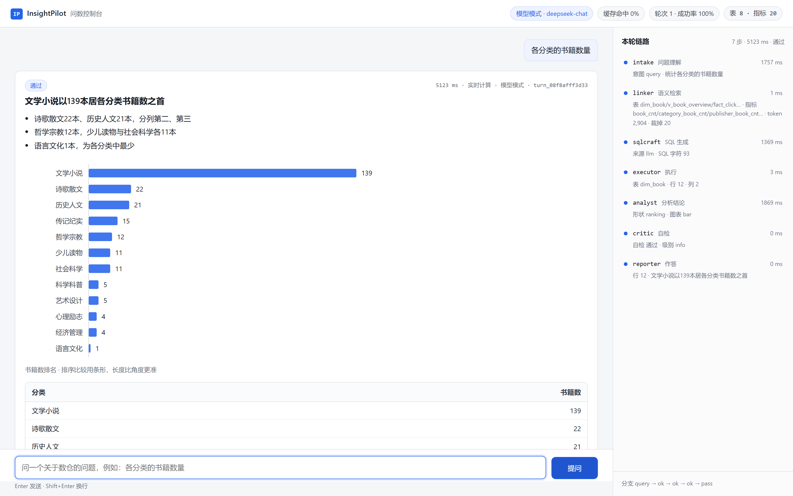

# InsightPilot · 多智能体自助问数平台

业务同学用中文问一句，系统自动完成 **理解意图 → 定位数据 → 写 SQL → 安全执行 → 统计选图 → 自检**，
输出结论、图表和口径说明。全过程可追溯、可评测、有安全边界。



> 上图是真实运行截图（`scripts/shots.py` 抓取，非设计稿）：右侧栏是 7 个节点的真实耗时与召回依据。

| | |
|---|---|
| 60 题评测集 | 严格 EX **50.0%**，列覆盖一致 **57.5%**（两轮均值）；规则基线 18.3% |
| 测试 | 267 个用例，全绿 |
| 端到端延迟 | p50 约 5.7 s（含 3 次模型调用）；规则基线 p50 约 40 ms |
| 单题成本 | 约 ¥0.005（约 4900 token/题，DeepSeek-chat） |
| 零配置可跑 | 不配 API Key 也能完整走通界面、SSE、trace、评测 |

---

## 一句话设计主张

> 我不相信"大模型能写 SQL"这件事。我只相信"在受约束的语义层上，准确率能被度量"，
> 以及"每一个数字都能追回到一行结果"。
> 所以重心不在调 prompt，在**约束**和**度量**。

落在三条工程约束上：

1. **语义层前置**——不给模型整库 DDL，只给检索出的表卡片 + 指标口径 + 范例 SQL。
   "评分是 0-10 分不是 1-5 星"这种易错点写进配置，不指望模型每次想起来。
2. **数字由代码算**——统计、派生指标、结论里的每个数都由 `app/agents/stats.py` 计算；
   模型只负责措辞，措辞里的数字要回查结果集，查不到就丢弃它的表述。
3. **效果必须可度量**——60 题评测集 + 结果集等价判定 + 四组消融 + 重复性检验。
   没有对照组的"多 Agent 架构"只是看起来复杂。

---

## 快速开始

```bash
pip install -r requirements.txt
python scripts/doctor.py                          # 先自检：依赖/数据/语义层/Key
python -m uvicorn app.api.server:app --port 8000  # 打开 http://127.0.0.1:8000
```

三条命令跑完就能用。不配 Key 时默认走规则基线（`IP_LLM_MODE=stub`），界面、SSE、
trace、评测全部可用；想看模型效果再复制 `.env.example` 填 Key。

```bash
python scripts/tasks.py demo    # 等价于 make demo：强制规则基线启动，演示现场最稳
python scripts/tasks.py test    # 267 个测试
python scripts/tasks.py eval    # 四组消融全量评测
docker compose up --build       # 容器化（本机无 Docker，构建未实测）
```

> Windows 没有 `make`，用 `python scripts/tasks.py <同名任务>`，两边行为一致。

---

## 为什么不是"接个大模型写 SQL"

三个具体问题，各自对应一处实现：

| 问题 | 表现 | 这里的做法 |
|---|---|---|
| 模型猜字段 | 用了不存在的列、或该用 `rating_count` 却用了 `COUNT(*)` | 语义层三路召回（表卡/指标/范例），每次召回带 `hit_reason` 可解释 |
| 模型碰写操作 | `DROP`、`ATTACH`、子查询夹带非法表 | sqlglot 解析 AST 后判定：单条 SELECT + 表名白名单 + CTE 豁免 + 强制行数上限；54 条攻击样例 |
| 模型编数字 | 结论里出现结果集中没有的数 | 数字由代码算，措辞里的每个数回查结果集（含千分位归一化与可重算派生值） |

---

## 架构

```
用户提问
   │
① Intake ──(需澄清)──▶ 回问用户
   │            (澄清/超范围走这里，不硬答)
   ├─▶ ② Linker ──▶ ③ SQLCraft ──▶ ④ Executor
   │      语义层          生成 SQL        校验+沙箱执行
   │      三路召回                          │ 报错回灌 ≤3 次
   │                                        ▼
   │                                    ⑤ Analyst ──▶ ⑥ Critic
   │                                    统计/选图/结论    数字·样本·口径
   │                                        ▲              │ 不通过打回 ≤2 次
   │                                        └──────────────┘
   │                                                       ▼ 通过
   └────────────────────────────────────────────── 答复：SQL + 表 + 图 + 口径
```

| 层 | 目录 | 职责 |
|---|---|---|
| 接入 | `app/api/`、`app/mcp/` | FastAPI 路由、SSE 节点级事件流、静态页；MCP stdio 服务端 |
| 编排 | `app/harness/` | 状态图引擎：节点注册、条件边、检查点、max_steps 保护 |
| Agent | `app/agents/` | 6 个 Agent + 统计 + 提示词 + 两个 Inferencer |
| 语义 | `app/semantic/` | YAML 加载、手写 BM25、三路召回、预算裁剪 |
| 执行 | `app/db/` | sqlglot AST 白名单校验、只读沙箱、超时与行长上限 |
| 观测 | `app/obs/` | trace 落 SQLite + 树形可视化 |
| 评测 | `app/eval/` | 结果集等价 + 列覆盖判定、消融运行器、报告生成 |
| 数据 | `data/` | 星型模型快照 + 语义层配置（含输出约定）+ 60 题 gold 集 |

更细的选型理由见 [`docs/02-架构与取舍.md`](docs/02-架构与取舍.md)：为什么手写状态图而不是
LangGraph、为什么不用向量库、为什么 SQL 校验必须过 AST、为什么图表服务端出 SVG。

---

## 评测

> 60 题，6 类各 10 题。判定是**结果集等价**，不是 SQL 字符串比对：列名不比、行序不比、
> 数值 1e-6 相对容差。每个配置跑 **2 轮**，下表为均值；单轮数据见 `docs/03-评测报告.md`，
> 噪声分析见 `docs/03b-重复性检验.md`。
>
> 两个指标并列：**EX** 要求列数与金标准完全相等；**覆盖一致**允许预测多带列，
> 只要金标准每列都能按值对上、行不错位。

| 配置 | EX（两轮均值） | 两轮原始值 | 覆盖一致 | 规则基线对照 |
|---|---|---|---|---|
| full（6 Agent 全开） | **50.0%** | 50.0% / 50.0% | 57.5% | 18.3% |
| no_critic（关自检） | 50.8% | 51.7% / 50.0% | 56.7% | 18.3% |
| no_schema（关语义层检索） | 45.0% | 43.3% / 46.7% | 57.5% | 16.7% |
| single（单链路、无检索无自检） | 45.0% | 45.0% / 45.0% | 57.5% | 16.7% |

**怎么读这张表（别跳过）**

- **规则基线 18.3% → 模型模式 50.0%，+31.7 个百分点**，这是整张表里唯一远超噪声的对比。
- 去掉语义层检索、或退化成单 Agent，各掉 5.0 个百分点，**方向符合预期**。但 `no_schema`
  的两轮波动有 3.4pp（43.3% / 46.7%），5pp 的提升只比它大一点——**n=2 撑不起"显著"这个词**，
  所以这里只说方向，不说因果。
- **去掉 Critic 反而高 0.8pp**（50.8% vs 50.0%），在噪声带内，**等于这个模块没测出收益**。
  保留它是因为它拦的是"结论里的数字对不上结果集"，不改 SQL，本来就不该影响 EX。
  如果只能留两个 Agent，留 Linker 和 Executor。
- **覆盖一致四组几乎持平**（57.5 / 56.7 / 57.5 / 57.5）。也就是说，多 Agent 带来的差异
  主要在"投影是否收敛"，不在"信息是否正确"。这个结论和直觉相反，但数据就是这样。

**失败构成**（full 单轮 30 个失败）：28 个"SQL 跑通但结果不等价"——18 个列数不同、
8 个取值不同、2 个行数不同；另外 1 个被安全策略拒绝、1 个走了澄清。28 个里只有 4 个
是"纯粹多带列"（覆盖判定通过），其余都伴随取值或粒度错误。逐题归因见
`docs/03-评测报告.md` 第 5 节。

**关于 +6.7pp 的说明**：上一版是 43.3%（41.7% / 45.0%）。这一版的提升里，有一部分来自
修正了 8 道"题面问一本、金标准给 5 行"的矛盾题（见 `docs/06-评测集审计.md`），**不是系统变强**。
我没有做单因素实验把这部分拆开，所以不把它写成"优化带来的提升"。

复现：

```bash
python scripts/run_eval.py --variants full,single,no_schema,no_critic --mode auto --out docs/
python scripts/run_eval.py --variants full --mode auto --gold data/gold.v1.jsonl --out _work/v1
python scripts/repeatability.py --runs <run1> <run2> --out docs/03b-重复性检验.md
```

---

## MCP 接入

问数能力可以暴露成标准工具，供 Claude Desktop / Cursor / 其他 Agent 调用：

```json
{
  "mcpServers": {
    "insightpilot": {
      "command": "python",
      "args": ["scripts/mcp_server.py"],
      "cwd": "<项目根目录>"
    }
  }
}
```

三个工具：`ask_data`（中文问数，返回结论 + SQL + 表格）、`list_tables`（表与字段）、
`describe_metric`（指标口径与陷阱）。

协议按 JSON-RPC 2.0 手写，不引官方 SDK——这样保持零新增依赖，且 stdout 纯净性、通知不响应、
错误分层这三件事都能被测试守住（`tests/test_mcp_server.py` 里有子进程级验证）。

---

## 能力边界（不吹的部分）

| 项 | 实际情况 |
|---|---|
| 数据规模 | 万级事实表（250 书 / 4202 评分 / 9028 点击 / 1976 评论 / 2532 书架），**不是海量数据** |
| 时间跨度 | 快照只覆盖 2026-10-18 与 2026-11-01 两天且都是周日，趋势类问题区分度有限 |
| 部署形态 | 单机版，没有分布式、没有高并发压测，SQLite 单文件 |
| 多轮 | 支持指代消解（"再按出版社拆一下"），不做跨会话长期记忆 |
| 权限 | 单租户，没有行级权限与数据脱敏 |
| 准确率 | 严格 EX 50.0%、覆盖一致 57.5%（两轮均值）。**这个数字不高**，失败构成见评测报告 |
| 架构收益 | 消融组间极差小于重复波动，**不声称多 Agent 带来提升** |
| 容器 | Dockerfile 与 compose 已就绪，但本机未装 Docker，**构建未实测** |

---

## 目录

```
insightpilot/
├─ app/
│  ├─ api/        server.py（8 个路由，含 SSE）
│  ├─ harness/    graph.py 状态图引擎 / context.py / checkpoint.py
│  ├─ agents/     nodes.py 6 个 Agent / stats.py 统计 / inferencers.py 两条推理路径
│  ├─ semantic/   loader.py / bm25.py / retriever.py
│  ├─ db/         guard.py AST 校验 / repo.py 只读沙箱
│  ├─ mcp/        server.py MCP stdio 服务端
│  ├─ obs/        trace.py 落库与回放
│  └─ eval/       compare.py（EX + 列覆盖）/ runner.py / report.py
├─ data/          warehouse.sqlite / semantic/*.yml / gold.jsonl / gold.v1.jsonl
├─ web/           index.html + app.js + style.css（零构建、零 CDN）
├─ scripts/       etl.py / run_eval.py / doctor.py / mcp_server.py / shots.py / tasks.py
├─ tests/         267 个用例
└─ docs/          项目方案 / 实现契约 / 评测报告 / 架构取舍 / 开发纪实 / 评测集审计
```

## 文档索引

| 文件 | 内容 |
|---|---|
| `docs/00-项目方案.md` | 立项思路、与同类项目的差异、阶段计划 |
| `docs/01-实现契约.md` | 接口契约与 YAML 格式规范（含输出约定） |
| `docs/02-架构与取舍.md` | 分层设计、10 项选型的"为什么不用 X" |
| `docs/03-评测报告.md` | 四组消融、双判定指标、成本维度、失败清单 |
| `docs/03b-重复性检验.md` | 多轮重复实验，量化噪声带 |
| `docs/04-开发纪实.md` | 数据坑、8 个真实 bug、以及一次被自己推翻的结论 |
| `docs/05-简历素材.md` | 三版简历条目 + 16 个追问预案 |
| `docs/06-评测集审计.md` | 修正 8 道题面与金标准的矛盾，保留 v1 快照 |
