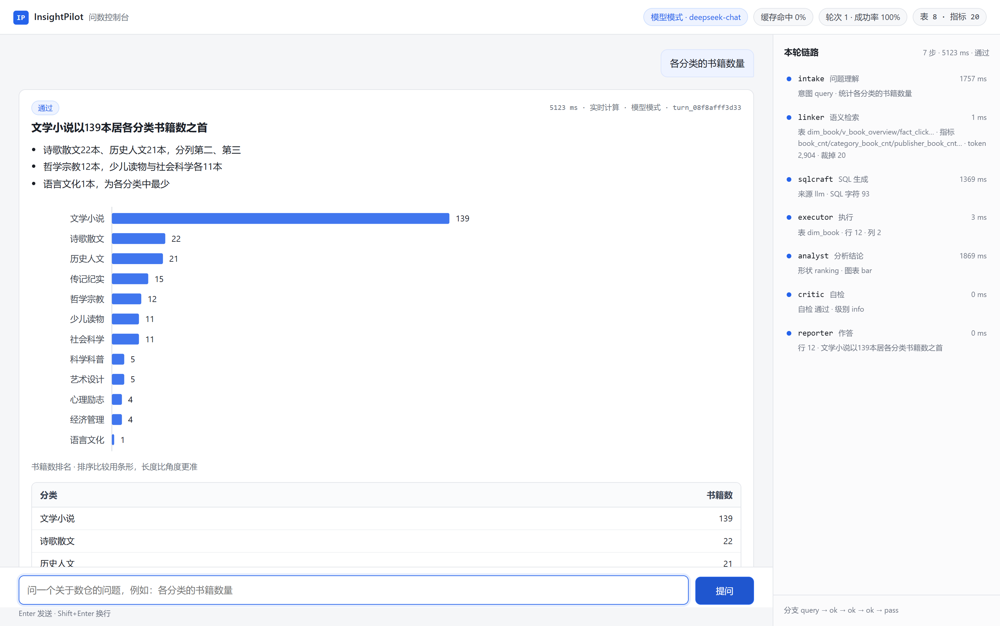

# InsightPilot · 多智能体自助问数平台

[](https://github.com/heji110705/InsightPilot/actions/workflows/ci.yml)

业务同学用中文问一句，系统自动完成 **理解意图 → 定位数据 → 写 SQL → 安全执行 → 统计选图 → 自检**，
输出结论、图表和口径说明。全过程可追溯、可评测、有安全边界。



> 上图是真实运行截图（`scripts/shots.py` 抓取，非设计稿）：右侧栏是 7 个节点的真实耗时与召回依据。

**在线 Demo：<http://8.163.90.97:8001/>**（阿里云 ECS 2C2G + Docker Compose，点开即问，无需注册）
· 同机还有 **DocuMind <http://8.163.90.97/>**（文档问答）
· 部署与防刷说明见 [`deploy/`](deploy/) 与本文末「线上部署」一节

> Demo 跑在 **`deepseek-chat`** 上（与 DocuMind **同一个模型、同一把 key**），不是离线模板。
> 问一句平均 **2.98 次模型调用、4,985 token、p50 4.2 秒**（60 题实测，2026-11-19）。
> 与 DocuMind 共用一把 key：额度是同一个池子，但**成本按站点分别对账**（响应带 `model_used`），
> 比"各自 1M 免费额度、谁先耗完谁 500"可控——额度可以充，静默 403 不行。

| | |
|---|---|
| 60 题评测集 | 严格 EX **51.7%（31/60，两轮一致）**，列覆盖一致 **58.3%（35/60）**（2026-11-19，`deepseek-chat`，产品配置 = 关自检）；规则基线 **18.3%（11/60）** |
| 测试 | **295 个用例，全绿**（本地与 CI 同一套依赖；`test_etl` 用仓库内快照，不再依赖本机源库） |
| 端到端延迟 | p50 **4,647 ms** / p95 **5,657–6,454 ms**（60 题两轮；引擎内口径）；规则基线 p50 **84 ms** / p95 **114 ms** |
| 单题成本 | **¥0.00534**（4,979 token/题，`deepseek-chat` 1.07 / 4.29 元每百万；60 题合计约 ¥0.32/轮） |
| 零配置可跑 | 不配 API Key 也能完整走通界面、SSE、trace、评测 |

> `data/source_snapshot.sqlite`（2.2MB）是 ETL 契约测试用的源数据快照，只含 ETL 用到的 7 张表、
> **不含 `auth_user` / `users_profile`**。放进仓库的原因：源库原本只在本机 `D:/biyesheji/`，
> CI 上不存在，那 3 条 ETL 测试等于从没在 CI 里跑过。

---

## 0. 模型与口径

- **当前生产模型**：`deepseek-chat`（非思考模式），与 DocuMind 同模型、同 key。
- **评测模型**：与生产同一个——下面所有 EX 数字都在 `deepseek-chat` 上测，**不再跨模型拼数字**。
- **切换日期与原因**：2026-11-19 从百炼 `qwen3.8-flash` 切来。一句话：免费额度不可预期
  （3.8-flash 只剩 2.3 万 token，按 3.3k/题只够 7 问，第 8 问直接 403），
  且备用模型引用编号会越界（`[16]`），共享额度不如共享一把可付费的 key。
- **历史口径在哪**：切模型前那版 4 档表（50.0 / 50.8 / 45.0 / 45.0）留在
  §评测 的「旧值」列与 git 历史里，与当前数字**并排放、不覆盖**；`docs/03-评测报告.md`
  是本次（2026-11-19）的结果。DocuMind 侧的历史口径见其 README §2.1「口径 A」。

## 一句话设计主张

> 我不相信"大模型能写 SQL"这件事。我只相信"在受约束的语义层上，准确率能被度量"，
> 以及"每一个数字都能追回到一行结果"。
> 所以重心不在调 prompt，在**约束**和**度量**。

落在三条工程约束上：

1. **语义层前置**——不给模型整库 DDL，只给检索出的表卡片 + 指标口径 + 范例 SQL。
   "评分是 0-10 分不是 1-5 星"这种易错点写进配置，不指望模型每次想起来。
2. **数字由代码算**——统计、派生指标、结论里的每个数都由 `app/agents/stats.py` 计算；
   模型只负责措辞，措辞里的数字要回查结果集，查不到就丢弃它的表述。
3. **效果必须可度量**——60 题评测集 + 结果集等价判定 + 四组消融 + 重复性检验。
   没有对照组的"多 Agent 架构"只是看起来复杂。

---

## 快速开始

```bash
pip install -r requirements.txt
python scripts/doctor.py                          # 先自检：依赖/数据/语义层/Key
python -m uvicorn app.api.server:app --port 8000  # 打开 http://127.0.0.1:8000
```

三条命令跑完就能用。不配 Key 时默认走规则基线（`IP_LLM_MODE=stub`），界面、SSE、
trace、评测全部可用；想看模型效果再复制 `.env.example` 填 Key。

```bash
python scripts/tasks.py demo    # 等价于 make demo：强制规则基线启动，演示现场最稳
python scripts/tasks.py test    # 267 个测试
python scripts/tasks.py eval    # 四组消融全量评测
docker compose up --build       # 容器化（本机无 Docker，构建未实测）
```

> Windows 没有 `make`，用 `python scripts/tasks.py <同名任务>`，两边行为一致。

---

## 为什么不是"接个大模型写 SQL"

三个具体问题，各自对应一处实现：

| 问题 | 表现 | 这里的做法 |
|---|---|---|
| 模型猜字段 | 用了不存在的列、或该用 `rating_count` 却用了 `COUNT(*)` | 语义层三路召回（表卡/指标/范例），每次召回带 `hit_reason` 可解释 |
| 模型碰写操作 | `DROP`、`ATTACH`、子查询夹带非法表 | sqlglot 解析 AST 后判定：单条 SELECT + 表名白名单 + CTE 豁免 + 强制行数上限；54 条攻击样例 |
| 模型编数字 | 结论里出现结果集中没有的数 | 数字由代码算，措辞里的每个数回查结果集（含千分位归一化与可重算派生值） |

---

## 架构

```
用户提问
   │
① Intake ──(需澄清)──▶ 回问用户
   │            (澄清/超范围走这里，不硬答)
   ├─▶ ② Linker ──▶ ③ SQLCraft ──▶ ④ Executor
   │      语义层          生成 SQL        校验+沙箱执行
   │      三路召回                          │ 报错回灌 ≤3 次
   │                                        ▼
   │                                    ⑤ Analyst ──▶ ⑥ Critic
   │                                    统计/选图/结论    数字·样本·口径
   │                                        ▲              │ 不通过打回 ≤2 次
   │                                        └──────────────┘
   │                                                       ▼ 通过
   └────────────────────────────────────────────── 答复：SQL + 表 + 图 + 口径
```

| 层 | 目录 | 职责 |
|---|---|---|
| 接入 | `app/api/`、`app/mcp/` | FastAPI 路由、SSE 节点级事件流、静态页；MCP stdio 服务端 |
| 编排 | `app/harness/` | 状态图引擎：节点注册、条件边、检查点、max_steps 保护 |
| Agent | `app/agents/` | 6 个 Agent + 统计 + 提示词 + 两个 Inferencer |
| 语义 | `app/semantic/` | YAML 加载、手写 BM25、三路召回、预算裁剪 |
| 执行 | `app/db/` | sqlglot AST 白名单校验、只读沙箱、超时与行长上限 |
| 观测 | `app/obs/` | trace 落 SQLite + 树形可视化 |
| 评测 | `app/eval/` | 结果集等价 + 列覆盖判定、消融运行器、报告生成 |
| 数据 | `data/` | 星型模型快照 + 语义层配置（含输出约定）+ 60 题 gold 集 |

更细的选型理由见 [`docs/02-架构与取舍.md`](docs/02-架构与取舍.md)：为什么手写状态图而不是
LangGraph、为什么不用向量库、为什么 SQL 校验必须过 AST、为什么图表服务端出 SVG。

---

## 评测

> 60 题，6 类各 10 题。判定是**结果集等价**，不是 SQL 字符串比对：列名不比、行序不比、
> 数值 1e-6 相对容差。
>
> **本次口径（2026-11-19，`deepseek-chat`）**：产品配置（`full` 与 `no_critic`）各跑 **2 轮**，
> `no_schema` / `single` 各 1 轮；逐题明细见 `docs/03-评测报告.md`。
> 旧值是切模型前的两轮均值，只作对照列，不覆盖。
> **单配置的运行间波动实测为 0–2 题（0–3.3pp）**，所以任何小于 2 题的组间差异都只写方向。
>
> 两个指标并列：**EX** 要求列数与金标准完全相等；**覆盖一致**允许预测多带列，
> 只要金标准每列都能按值对上、行不错位。

| 配置 | EX（本次，含轮次） | 旧值（切模型前） | 覆盖一致 | 单题 token | 单题成本 |
|---|---|---|---|---|---|
| full（6 Agent 全开，**非产品配置**） | 43.3% / 45.0%（26、27/60） | 50.0% | 53.3%（32/60） | 4,993 | ¥0.00536 |
| no_critic（关自检，**= 产品默认**） | **51.7% / 51.7%（31、31/60）** | 50.8% | 58.3%（35/60） | 4,979 | ¥0.00534 |
| no_schema（关语义层检索） | 43.3%（26/60，1 轮） | 45.0% | 51.7%（31/60） | 5,893 | ¥0.00627 |
| single（单链路、无检索无自检） | 38.3%（23/60，1 轮；改节点前 41.7%＝25/60） | 45.0% | 50.0%（30/60） | 5,874 | ¥0.00624 |

**四档一句话**：full **43.3–45.0%** ／ **no_critic 51.7%（= 产品配置）** ／
no_schema **43.3%** ／ single **38.3%**（改节点前是 41.7%，见 `_work/repeat2/03-评测报告.md`；
`docs/03-评测报告.md` 里的 single 一行是改前的 25/60，文件头已注明口径差异）。
报数只报 no_critic：产品默认就是它，`full` 不是。

规则基线（`--mode template`，不调模型）：**18.3%（11/60）**，p50 84 ms / p95 114 ms。
延迟明细（引擎内 `elapsed_ms`，60 题）：规则基线 **p50 84 / p95 114**；
full **4,234 / 5,368**（轮 1）、**4,572 / 5,702**（轮 2）；no_critic **4,647 / 6,454**（轮 1）、
**4,693 / 5,657**（轮 2）。单位 ms。

**怎么读这张表（别跳过）**

- **规则基线 18.3% → 产品配置 51.7%，+33.4 个百分点**（两轮一致）。
  若按 `full` 档算则是 **+26.7pp**（45.0%）——两个数都对，但口径不同，
  **产品实际跑的是 no_critic**，所以对外报 **51.7%**。
- **换模型的影响分档**：`full` 从 50.0% 掉到 45.0%（−5pp），`no_critic` 从 50.8% 到 51.7%，
  基本持平。所以"换模型整体掉 5pp"只对全开档成立，不能一句话概括。
- **自检（critic）是负收益，已默认关闭**：5 次观测里 `no_critic` 从未低于 `full`——
  31 / 31 / 29 vs 27 / 26，差 **2–5 题（3.3–8.3pp）**，超出 0–2 题的波动范围。
  qwen 时代那组只差 0.8pp（1 题以内），换模型后差距变大：**它会把原本答对的结论推翻。**
  处理方式与 DocuMind 的 failover 相同——能力留着、默认不用、原因写进启动日志：
  `[agent] critic=off reason=ablation_negative`；打开用 `IP_ENABLE_CRITIC=1`。
  代码与单测都没删（`tests/test_critic_gate.py` 5 条）。
- **语义层检索在当前样本上测不出差异**：`no_schema` 43.3% 与 `full` 43.3%（26/60）持平，
  旧表是 45.0 vs 50.0。这个结论比之前更弱——只能说"没测出收益"，不能说"关掉没损失"。
- **单链路明显更差**：38.3%（23/60），比产品配置低 8 题。方向稳定，可以下结论。

**失败构成**（产品配置 `no_critic` 第 1 轮，29 个失败）：28 个"SQL 跑通但结果不等价"——
**20 个列数不同、8 个取值不同、1 个行数不同**（按主因归类）；另 1 个走了澄清。
列数不同仍占三分之二，主要矛盾是**投影收敛**（多带列/少带列），不是算错数。
逐题清单见 `docs/03-评测报告.md` 第 5 节（那一版是全开档的清单）。

**关于更早那次 +6.7pp（历史记录，与本次无关）**：那一版从 43.3% 提到 50.0%，其中一部分来自
修正了 8 道"题面问一本、金标准给 5 行"的矛盾题（见 `docs/06-评测集审计.md`），**不是系统变强**；
没有做单因素实验拆开，所以当时也没写成"优化带来的提升"。这个数据集上的分数对条件很敏感，
**报数字必须带口径**。

复现：

```bash
python scripts/run_eval.py --variants full,single,no_schema,no_critic --mode auto --out docs/
python scripts/run_eval.py --variants full --mode auto --gold data/gold.v1.jsonl --out _work/v1
python scripts/repeatability.py --runs <run1> <run2> --out docs/03b-重复性检验.md
```

---

## MCP 接入

问数能力可以暴露成标准工具，供 Claude Desktop / Cursor / 其他 Agent 调用：

```json
{
  "mcpServers": {
    "insightpilot": {
      "command": "python",
      "args": ["scripts/mcp_server.py"],
      "cwd": "<项目根目录>"
    }
  }
}
```

三个工具：`ask_data`（中文问数，返回结论 + SQL + 表格）、`list_tables`（表与字段）、
`describe_metric`（指标口径与陷阱）。

协议按 JSON-RPC 2.0 手写，不引官方 SDK——这样保持零新增依赖，且 stdout 纯净性、通知不响应、
错误分层这三件事都能被测试守住（`tests/test_mcp_server.py` 里有子进程级验证）。

---

## 能力边界（不吹的部分）

| 项 | 实际情况 |
|---|---|
| 数据规模 | 万级事实表（250 书 / 4202 评分 / 9028 点击 / 1976 评论 / 2532 书架），**不是海量数据** |
| 时间跨度 | 快照只覆盖 2026-10-18 与 2026-11-01 两天且都是周日，趋势类问题区分度有限 |
| 部署形态 | 单机版，没有分布式、没有高并发压测，SQLite 单文件 |
| 多轮 | 支持指代消解（"再按出版社拆一下"），不做跨会话长期记忆 |
| 权限 | 单租户，没有行级权限与数据脱敏 |
| 准确率 | 严格 EX **51.7%（31/60，两轮一致）**、覆盖一致 **58.3%**（2026-11-19，`deepseek-chat`，产品配置=关自检）。**这个数字不高**，失败构成见评测报告 |
| 架构收益 | 消融组间极差小于重复波动，**不声称多 Agent 带来提升** |
| 容器 | Dockerfile 与 compose 已就绪，但本机未装 Docker，**构建未实测** |

---

## 目录

```
insightpilot/
├─ app/
│  ├─ api/        server.py（8 个路由，含 SSE）
│  ├─ harness/    graph.py 状态图引擎 / context.py / checkpoint.py
│  ├─ agents/     nodes.py 6 个 Agent / stats.py 统计 / inferencers.py 两条推理路径
│  ├─ semantic/   loader.py / bm25.py / retriever.py
│  ├─ db/         guard.py AST 校验 / repo.py 只读沙箱
│  ├─ mcp/        server.py MCP stdio 服务端
│  ├─ obs/        trace.py 落库与回放
│  └─ eval/       compare.py（EX + 列覆盖）/ runner.py / report.py
├─ data/          warehouse.sqlite / semantic/*.yml / gold.jsonl / gold.v1.jsonl
├─ web/           index.html + app.js + style.css（零构建、零 CDN）
├─ scripts/       etl.py / run_eval.py / doctor.py / mcp_server.py / shots.py / tasks.py
├─ tests/         267 个用例
└─ docs/          项目方案 / 实现契约 / 评测报告 / 架构取舍 / 开发纪实 / 评测集审计
```

## 文档索引

| 文件 | 内容 |
|---|---|
| `docs/00-项目方案.md` | 立项思路、与同类项目的差异、阶段计划 |
| `docs/01-实现契约.md` | 接口契约与 YAML 格式规范（含输出约定） |
| `docs/02-架构与取舍.md` | 分层设计、10 项选型的"为什么不用 X" |
| `docs/03-评测报告.md` | 四组消融、双判定指标、成本维度、失败清单 |
| `docs/03b-重复性检验.md` | 多轮重复实验，量化噪声带 |
| `docs/04-开发纪实.md` | 数据坑、8 个真实 bug、以及一次被自己推翻的结论 |
| `docs/05-简历素材.md` | 三版简历条目 + 18 个追问预案（数字对齐 v5 实测） |
| `docs/06-评测集审计.md` | 修正 8 道题面与金标准的矛盾，保留 v1 快照 |
| `docs/09-原型自测与修复记录.md` | 5 屏原型的 23 项交互用例、根因与改法 |
| `docs/10-完整链路实测与口径对齐.md` | 12 条问题在真链路上的实测、四处口径分歧，以及「能不能不走链路直接答」的边界 |

---

## 线上部署（阿里云 ECS 2C2G，与 DocuMind 同机）

部署文件在 [`deploy/`](deploy/)：`Dockerfile.vps`（FROM 走国内源）+
`docker-compose.vps.yml`（`ports: 8001:8000`、`env_file: .env`、`mem_limit: 512m`）。

```bash
# 服务器上，项目根目录
docker compose -f docker-compose.vps.yml up -d --build
curl -s http://127.0.0.1:8001/api/health    # 看 mode 是不是 api
```

### 环境变量

| 变量 | 线上值 | 说明 |
|---|---|---|
| `IP_LLM_MODE` | `api` | `stub` = 规则模板（零 key 可跑）；`api` = 真模型 |
| `IP_LLM_BASE_URL` | `https://api.deepseek.com/v1` | OpenAI 兼容；这也是代码默认值（`app/core/config.py:77`） |
| `IP_LLM_MODEL` | `deepseek-chat` | 与 DocuMind **同一个模型、同一把 key**——两站成本可以放在一起对账 |
| `IP_LLM_EXTRA_BODY` | 空 | 千问专用的 `enable_thinking` 已随切模型移除——DeepSeek 不认识这个字段 |
| `IP_ENABLE_CRITIC` | `0` | 自检节点开关。**默认关**：60 题消融里它是负收益（full 45.0% vs no_critic 51.7%）。关掉=链路上没有这个节点，启动日志打 `[agent] critic=off reason=ablation_negative` |
| `IP_PRICE_IN_PER_M` / `IP_PRICE_OUT_PER_M` | `1.07` / `4.29` | DeepSeek 公开价（元/百万 token），只用于折算展示 |
| `IP_RATE_PER_MIN` / `IP_RATE_PER_DAY` / `IP_RATE_DAILY_TOTAL` | `6` / `20` / `60` | 公开演示的防刷闸门 |

`.env` 被 `.dockerignore` 挡在镜像外，所以配置走 `env_file` 在运行期注入——
**Key 不该跟着镜像走**。这也意味着改配置只需 `--force-recreate`，不用重建镜像。

### 公开演示的防刷（`app/limits.py`）

无鉴权的 Demo，任何人拿到 IP 都能问，而一次问数是 3~6 次模型调用。三层限制：

| 层 | 目的 |
|---|---|
| 每 IP 每分钟 6 次 | 挡脚本（高并发、固定 IP） |
| 每 IP 每天 20 次 | 挡单个访客把额度用光 |
| 全站每天 60 次 | 挡换 IP / 分布式刷法，损失封顶 |

只拦 `POST /api/ask` 与 `/api/ask/stream`；`/api/stats` 是前端轮询的，拦了等于页面自己刷自己。
`check` / `hit` 分两步，422 参数校验失败不扣额度；限流器自身异常时**放行**（fail-open）。

实测（同一 IP 连发）：

```
第 1~6 次 200 → 第 7 次 429 {"detail":"请求过于频繁（每分钟最多 6 次）"}
期间 /、/api/stats 全部 200
```

### 内存实测（`docker stats`）

| 容器 | 常驻 | 上限 |
|---|---|---|
| documind | 约 845~897 MiB | 未设（3g > 物理内存，等于不限） |
| insightpilot | **51~72 MiB** | 512 MiB |
| 宿主可用 | 约 400 MiB | 物理 1.7 GB + 4 GB swap |

比预估的 300 MB 小得多：模型不在本地，进程只装 Python + pandas + 一次请求的状态。
并发 4 个 DocuMind 提问期间，它仍 78 ms 返回 200。

### 公开演示的四条加固（2026-11-16）

| 问题 | 改法 | 验证 |
|---|---|---|
| `/api/traces` 把**所有访客**问过的问题列出来 | 必须带 `?session=<会话号>`，不传返回空列表；单条详情仍按随机 `turn_id` 可取 | `curl /api/traces` → `count:0` |
| `/docs` 与 `/openapi.json` 公网可读，等于接口地图 | 默认关闭（`IP_DOCS=1` 可开） | 两个地址均 404 |
| 过滤值写错（如 `category='四大名著'`）却报"没有数据" | 零行时回查该值是否存在，不存在就把真实取值列表回灌给模型重试一次（`app/db/probe.py`） | 问「武侠小说有哪些书」→ 链路出现 `sqlcraft → executor` 重试，最终 4 行 |
| 缓存永不过期、也不跟数据变化 | 默认 TTL 24h（`IP_CACHE_TTL_S`）；缓存键加入数仓文件指纹 | 过期条目当未命中并被删除；`cache_key` 随文件 mtime/size 变化 |

### 本次部署踩到的坑

1. **`.env` 被 `.dockerignore` 挡住，容器里没有它** → `load_settings()` 读不到，
   一直停在 `mode: stub`。改成 compose 的 `env_file` 后恢复正常。
   教训：`mode` 不对时先 `docker exec ... env | grep IP_`，别看代码。
2. **厂商私有参数不能塞进 payload 的标准字段**：`enable_thinking` 必须和 `max_tokens`
   平级（HTTP 请求体），不是 SDK 的 `extra_body` 关键字。这个实现了透传，
   并让标准字段**永远覆盖**透传值——否则一个写错的 JSON 能把 `max_tokens` 顶掉。
